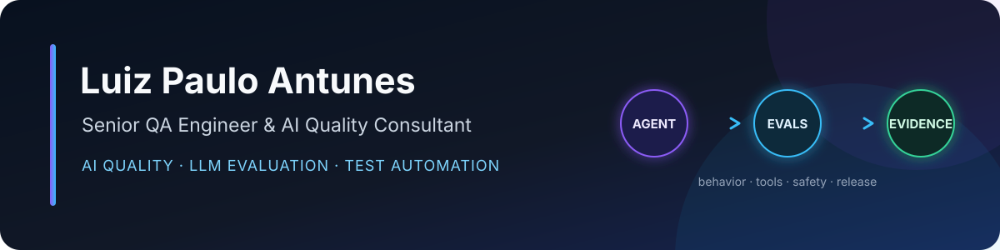

<p align="center">
  
</p>

<p align="center">
  <a href="https://www.linkedin.com/in/luiz-paulo-antunes-43116a23/"></a>
  <a href="https://github.com/luizpaulo-antunes?tab=repositories"></a>
  
</p>

## Building evidence for reliable AI systems

I am a **Senior QA Engineer focused on AI Quality** with 10+ years of experience in software quality, test automation, and technical QA leadership. I am based in Brazil and open to remote opportunities with international teams.

My current work is about one question: **what evidence should be required before an AI agent is released?** I build practical examples that make agent behavior observable and testable across APIs, contracts, RAG, MCP tools, security boundaries, evaluations, and CI.

### Featured engineering work

| Project | What it demonstrates |
| --- | --- |
| [**Agent Release Gate Platform**](https://github.com/luizpaulo-antunes/agent-release-gate-platform) | An integrated release gate for RAG agents and MCP tools: runtime contracts, RBAC, tenant isolation, adversarial evaluations, baseline regression checks, GitHub Actions, and redacted OpenTelemetry traces. |
| [**LLM Agent Evaluation Lab**](https://github.com/luizpaulo-antunes/llm-agent-evaluation-lab) | Versioned behavioral evaluation, safety checks, latency and cost signals, redacted observability, and repeatable CI. |
| [**Secure MCP Gateway Lab**](https://github.com/luizpaulo-antunes/secure-mcp-gateway-lab) | Authentication, least-privilege authorization, rate limiting, redacted audit events, and real MCP integration tests. |
| [**MCP Agent Quality Lab**](https://github.com/luizpaulo-antunes/mcp-agent-quality-lab) | API, contract, E2E, and behavioral testing for an agent that uses MCP tools, including grounding, privacy, and safe failures. |
| [**Anatomia Viva 3D**](https://github.com/luizpaulo-antunes/anatomia-viva-3d) | A human–AI collaboration case study: a local-first Python desktop product integrating versioned anatomical sources, 3D data pipelines, integrity checks, automated tests, and Windows delivery. |

The projects form a progression from isolated quality signals to an enforceable release decision:

```text
agent evaluation and observability
            +
secure MCP execution boundaries
            +
layered API, contract, and behavioral tests
            |
            v
baseline-aware CI release gate
```

### What I bring to a team

- AI-agent and LLM evaluation strategies that produce diagnosable release signals
- RAG relevance, groundedness, citation, and safe-failure testing
- MCP authentication, authorization, contract, and tenant-isolation validation
- TypeScript automation across API, integration, E2E, and behavioral layers
- CI quality gates, regression baselines, and privacy-aware observability

### Core stack

`TypeScript` · `Node.js` · `Playwright` · `MCP` · `LLM Evals` · `RAG` · `OpenAPI` · `AJV` · `OpenTelemetry` · `GitHub Actions`

### Let’s talk

I am open to remote **Senior QA, SDET, Test Automation, and AI Quality Engineering** roles, as well as focused consulting work around agent evaluation and MCP quality.

For opportunities or technical conversations, [contact me on LinkedIn](https://www.linkedin.com/in/luiz-paulo-antunes-43116a23/).
